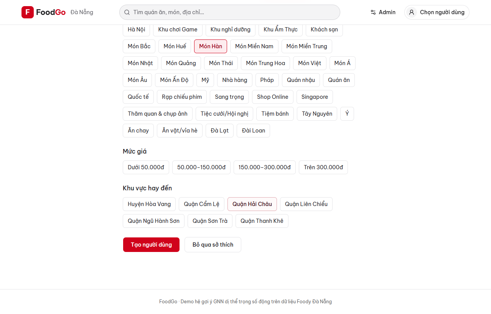
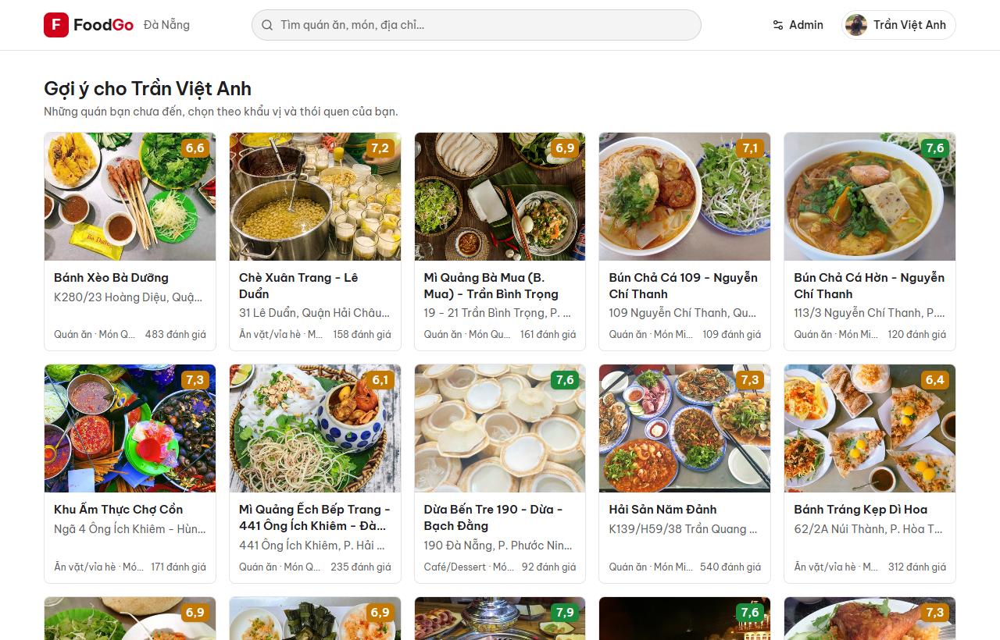
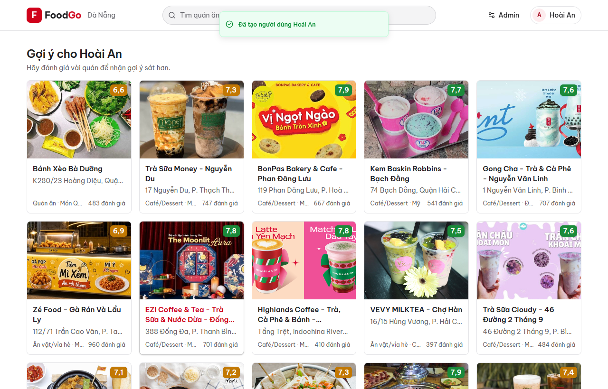
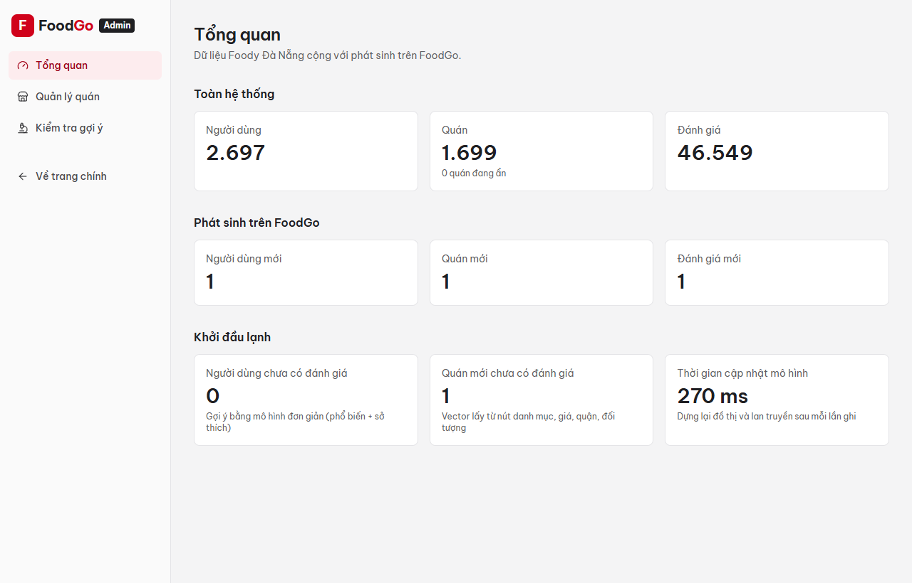
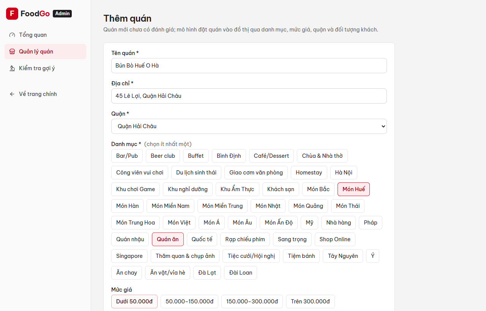
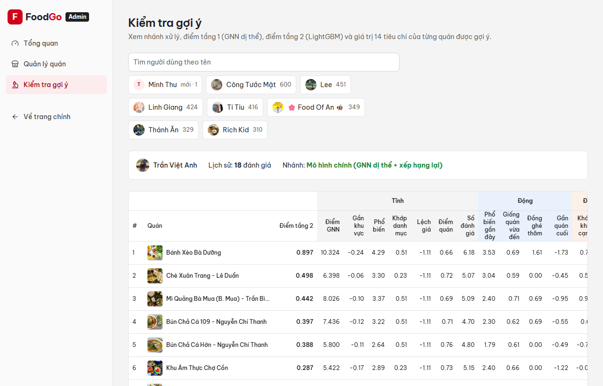
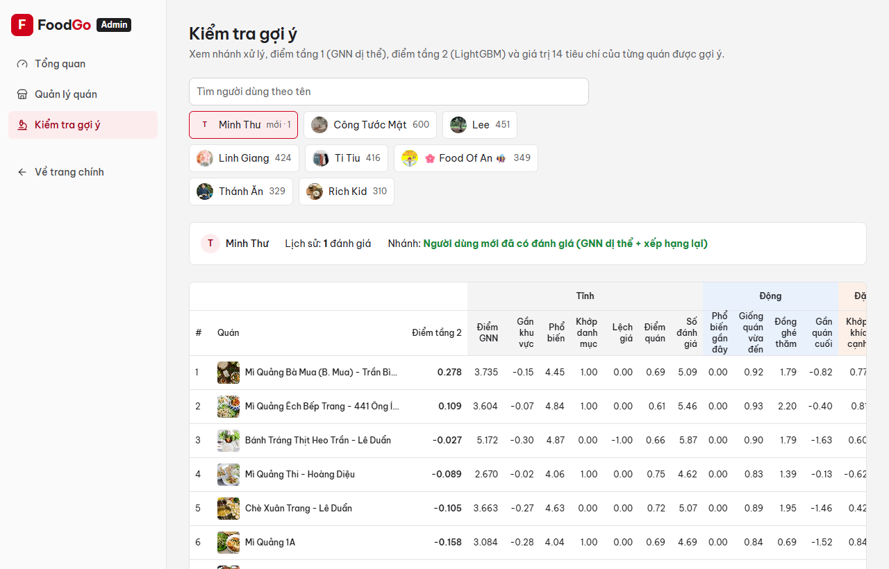

# FoodGo

Trang khám phá quán ăn Đà Nẵng chạy mô hình gợi ý đã huấn luyện trên dữ liệu Foody: GNN dị thể với trọng số cạnh động (tầng 1) và xếp hạng lại bằng LightGBM LambdaRank (tầng 2). Gợi ý cập nhật ngay sau mỗi đánh giá, không huấn luyện lại. Người dùng mới và quán mới được xử lý bằng nhánh khởi đầu lạnh.

Thiết kế: [docs/thiet-ke.md](docs/thiet-ke.md) · Kế hoạch: [docs/ke-hoach.md](docs/ke-hoach.md) · Hệ thiết kế giao diện: [docs/he-thiet-ke.md](docs/he-thiet-ke.md)

## Chức năng

### Người dùng

**Chọn hoặc tạo người dùng.** Không cần mật khẩu. Chọn một trong 2.696 người dùng thật của Foody Đà Nẵng, hoặc tạo người dùng mới kèm sở thích (danh mục, mức giá, quận). Có thể bỏ qua phần sở thích.

| Chọn người dùng có sẵn | Tạo người dùng mới |
|---|---|
|  |  |

**Trang chủ** gồm các mục:
- **Gợi ý cho bạn:** 20 quán người dùng chưa đến, do GNN dị thể và tầng xếp hạng lại LightGBM chọn.
- **Ghé lại quán quen:** quán đã chấm từ 7 điểm trở lên.
- **Quán mới:** quán admin vừa thêm.
- **Duyệt theo quận và danh mục.**

Chưa chọn người dùng thì trang chủ chỉ có lời mời chọn người dùng và phần duyệt quán.

| Chưa chọn người dùng | Gợi ý cá nhân hóa |
|---|---|
|  |  |

**Người dùng mới (khởi đầu lạnh).** Khi chưa có đánh giá nào, gợi ý dựa trên độ phổ biến và sở thích đã chọn. Ở ảnh dưới, người dùng chọn Café/Dessert, Món Hàn và Quận Hải Châu. Ngay sau đánh giá đầu tiên, người dùng được đưa vào đồ thị và nhận gợi ý từ mô hình chính.



**Tìm kiếm:**
- Tìm theo tên hoặc địa chỉ, gõ không dấu vẫn được.
- Lọc theo quận, danh mục, mức giá, đang mở cửa.
- Sắp xếp theo mức phù hợp với người đang chọn, điểm hoặc số đánh giá.

**Chi tiết quán:**
- Ảnh, giờ mở cửa, khoảng giá, 5 điểm khía cạnh, bản đồ OpenStreetMap, danh sách đánh giá.
- Mục "Quán tương tự", tính theo embedding GNN.
- Form viết đánh giá (1–10 điểm). Gửi xong, gợi ý của người dùng cập nhật ngay (khoảng 0,25 giây), không huấn luyện lại.

| Tìm kiếm và lọc | Chi tiết quán, viết đánh giá |
|---|---|
|  |  |

Giao diện dùng được trên điện thoại:


### Admin (`/admin`)

- **Tổng quan:** số người dùng, quán, đánh giá; số phát sinh trên FoodGo; số người dùng và quán đang ở trạng thái lạnh; thời gian cập nhật mô hình.
- **Quản lý quán:** thêm, sửa, ẩn quán. Quán mới chưa có đánh giá vẫn được gợi ý ngay, vì nó được nối với các nút danh mục, mức giá, quận và đối tượng khách trong đồ thị.
- **Kiểm tra gợi ý:** với một người dùng, xem nhánh xử lý (mô hình chính hay mô hình đơn giản), điểm GNN, điểm tầng 2 và giá trị 14 tiêu chí của từng quán được gợi ý.

| Tổng quan | Thêm quán |
|---|---|
|  |  |

| Quán mới xuất hiện trên trang chủ | Kiểm tra gợi ý (mô hình chính) |
|---|---|
|  |  |

| Người dùng mới chưa có đánh giá | Sau đánh giá đầu tiên |
|---|---|
|  |  |

## Yêu cầu

- [uv](https://docs.astral.sh/uv/) (backend, Python 3.12 do uv tự cài)
- Node.js 20 trở lên (frontend)

## Chuẩn bị (một lần)

* [ ] 
  ```bash
  cd foodgo/backend
  uv sync
  # copy file mô hình từ notebooks/ket_qua_chay và xuất tham số GNN sang .npz (cần torch, chỉ dùng ở bước này)
  uv run --with torch --extra-index-url https://download.pytorch.org/whl/cpu scripts/export_model.py
  # tạo data/foodgo.db từ data/foody_processed và file crawl trong foody/
  uv run scripts/prepare_data.py

  cd ../frontend
  npm install
  ```

## Chạy

Hai cửa sổ dòng lệnh:

```bash
cd foodgo/backend && uv run uvicorn app.main:app --port 8000
cd foodgo/frontend && npm run dev
```

Mở http://localhost:5173 (trang chính) và http://localhost:5173/admin (quản trị). Tài liệu API: http://localhost:8000/docs.

## Trước buổi demo

Tạo lại DB sạch để xóa người dùng, quán và đánh giá thử nghiệm, rồi khởi động lại backend:

```bash
cd foodgo/backend && uv run scripts/prepare_data.py
```

## Kiểm tra

```bash
cd foodgo/backend
uv run pytest                      # 32 test: dữ liệu, GNN, tầng 2, engine, khởi đầu lạnh, API
uv run scripts/check_notebook.py   # chỉ số trên tập test phải khớp notebook: NDCG@20 0,1277, Recall@20 0,2363
```

## Kịch bản demo

1. **Gợi ý cá nhân hóa.** Bấm "Chọn người dùng", chọn một người có nhiều đánh giá. Trang chủ hiện "Gợi ý cho …" (mô hình chính) và "Ghé lại quán quen".
2. **Cập nhật ngay.** Mở một quán trong danh sách gợi ý, chấm điểm và gửi đánh giá. Về trang chủ: quán vừa đánh giá rời khỏi danh sách và thứ tự gợi ý thay đổi.
3. **Người dùng mới.** "Tạo người dùng mới", chọn vài danh mục và quận. Gợi ý ban đầu đến từ mô hình đơn giản (phổ biến + sở thích). Viết một đánh giá: người dùng chuyển sang GNN dị thể + xếp hạng lại.
4. **Quán mới.** Vào Admin, "Thêm quán", chọn danh mục, giá, quận, vị trí. Quán xuất hiện ở mục "Quán mới" trên trang chủ, xếp theo mức phù hợp với người đang chọn.
5. **Giải thích gợi ý.** Admin, "Kiểm tra gợi ý": chọn người dùng ở bước 1 và bước 3 để so sánh nhánh xử lý, điểm GNN, điểm tầng 2 và 14 tiêu chí của từng quán.

## Cấu trúc

```
backend/
  app/recsys/   catalog (ma trận thuộc tính), graph (đồ thị dị thể, trọng số động), propagate (lan truyền GNN),
                features (14 tiêu chí tầng 2 + LightGBM), cold (mô hình đơn giản), engine (trạng thái phục vụ)
  app/api/      public (người dùng), admin
  scripts/      export_model, prepare_data, check_notebook
frontend/src/
  pages/        Home, Users, NewUser, Search, PlaceDetail, Profile, admin/*
  components/   thẻ quán, lưới, đánh giá, bản đồ, header
artifacts/      tham số mô hình (gnn.npz, ranker.txt, train_meta.json)
data/           foodgo.db
```

## Ghi chú kỹ thuật

- Backend không cần PyTorch khi chạy: tham số embedding được xuất sang `artifacts/gnn.npz`, lan truyền làm bằng SciPy. Vector tính ra khớp vector notebook đã lưu (sai số < 1e-4).
- Mỗi lần ghi (đánh giá, người dùng, quán), backend dựng lại đồ thị và lan truyền lại toàn bộ, mất khoảng 0,25 giây.
- Đồng hồ hệ thống nối tiếp ngày cuối dữ liệu (12/07/2024) để trọng số thời gian và độ phổ biến gần đây có nghĩa. Đồng hồ này chỉ dùng trong backend; giao diện hiển thị ngày giờ thật.
